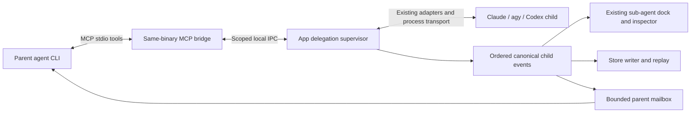

# Cross-agent runtime council — 2026-10-14

Status: council complete; reviewed architecture and delivery plan, implementation not started. This document adds no runtime, package, or user configuration changes.

Implementation hand-off: [Detailed implementation plan](2026-10-14_cross-agent-runtime-implementation.md), including fixed API fields, schema/transaction rules, eleven dependent work packages, acceptance matrix and rollback. Its more precise durability, migration and work-package requirements supersede the corresponding outline here.

## Objective

Make cross-provider delegation a first-class agent-terminal experience: one stable API, real child sessions, streaming activity in the existing sub-agent dock and inspector, provider branding, truthful model/effort metadata, and reliable parent/child communication. Include the integration in the shipped binary and provide installation/configuration support.

## Verified premises

- Working tree began at `79304abb`; pre-existing untracked `.playwright-mcp/` is outside this work.
- Installed `cross-agent` resolves to the homelab-scripts release binary. Its source, `~/scripts/crates/cross-agent/src/main.rs`, is a synchronous CLI: `print_mode_args` requests text output, `run` buffers through `command_output_timeout`, and Codex is explicitly ephemeral/read-only. There is no MCP server in that crate. Its Cargo manifest imports deployment-specific `homelab`.
- Live CLI version commands returned Claude `2.1.296`, agy `1.3.5`, Codex `0.161.0`.
- Agent-terminal already has provider-neutral adapters/events, `WorkersUpdated`/`WorkerSnapshot`, a dock (`src/chat/view/subagent_shelf.rs`) and inspector (`src/chat/view/subagents.rs`). `SubagentSummary` lacks explicit provider/model/effort identity.
- `Capabilities::live_input` is true for Claude/Codex and false for agy. A uniform API must return explicit delivery semantics rather than pretend all messages are injected immediately.
- `agent-core` is pure; process orchestration and GTK-dependent policy currently live in the app. Reusing adapters does not by itself reuse the host's permission enforcement.
- The entry point already dispatches `--approval-hook` before GTK setup; a headless MCP mode can follow that shape.
- Installed Claude help advertises `--mcp-config` and `--strict-mcp-config`; Codex app-server help advertises per-launch `-c` overrides. agy help has `mcp` management but no advertised per-launch MCP configuration override. This is a discovery gate, not evidence that agy can be wired identically.
- Codex currently drops `item/mcpToolCall/progress` in its `QUIET` list (`crates/agent-core/src/codex.rs:186`). Recognising an MCP tool name alone cannot recover the missing child activity.
- `agent-kit::store::scrub_envelope` explicitly documents a split-delta ceiling (`crates/agent-kit/src/store.rs:198–202`): fragments can be stored until an item snapshot/completion heals them. That eventual repair is insufficient for a new externally streamed child feed. A streaming-aware redaction boundary is a new prerequisite, not an already-solved property of the existing store.
- MCP progress carries optional request-scoped human-readable updates. It is not a guaranteed replayable child event stream. Tasks specifications are evolving; negotiate optional support instead of making it a prerequisite.

## Unverified premises / release gates

- Per-launch MCP configuration isolation and authenticated parent correlation across the installed CLI versions.
- Structured availability of effective model and effort for every provider; missing values must stay unknown.
- Live delivery of child completion/input-required events into each parent, particularly agy mid-turn.
- Multi-window shutdown, reconnection, and process-group termination for a real nested child tree.

## Council record

- Hive topic: `agent-terminal-cross-agent-runtime` (#39).
- Independent native seats: architect (deep task), experience designer / senior engineer (standard task), inherited GPT-6 model.
- Independent peer seats: Claude (`sonnet`) and agy (`pro` alias; actual model must be checked from peer output).
- Independent Claude/agy reviews both confirm that wrapping the synchronous CLI or relying on MCP progress alone cannot deliver the requested experience. Their peer aliases were requested explicitly; provider-reported effective peer model identities were not captured, so these are not proof of the actual underlying model.
- Claude recommends app-owned child sessions and a thin same-binary MCP bridge. agy's alternative lets each MCP server own children directly; the coordinator rejects that ownership for v1 because app UI attachment, approvals, client disconnects and lineage would otherwise need a second orchestration path.
- Coordinator pushback: peers' reviewer-only/write-in-AcceptEdits-only default is unnecessarily restrictive inside the existing GUI approval owner; Ask can safely request edits. The optional user scope question remains unanswered as of drafting, so the plan uses ordinary inherited approval limits and app-first scope as proposed defaults.
- Coordinator pushback: a peer's wait/inspect-only child-to-parent design is insufficient for the requested communication. Keep a durable source-attributed mailbox with safe-boundary delivery and visible queued notifications. Never fabricate immediate agy delivery or elevate child text into a user instruction.
- Coordinator pushback: a brief MCP bridge disconnect is not proof that the parent/root ended. App-owned workers survive a bridge reconnect; root revocation/closure is what stops the subtree. GUI crash recovery is explicitly limited.
- Coordinator corrections to peer claims: same executable with a headless mode need not violate standalone packaging; a Unix socket is not a network port. SO_PEERCRED establishes UID, not agent lineage. Extra serde fields need explicit defaults/version tests; serde's unknown-variant fallback alone is not field compatibility.
- Native architect Keel independently recommended the app-owned supervisor, compared it with a portable headless supervisor and an app-first/no-MCP slice, and conceded the same-binary bridge after cross-examination. He challenged caller-supplied parent identity, same-UID isolation claims, forced reviewer-only policy, worker closure on turn/disconnect and wait-only communication. All are reflected in the final contract.
- Native experience seat independently verified the existing inspector's nested workers, status groups, retained step widgets and approval/diff routing through `RowSink`. It supported one shared explorer, source-attributed mailbox messages and requested/effective metadata, and rejected progress-as-communication and identical-behaviour claims. Both native seats reported later source reads stalled; they assessed their initial source evidence and round-two briefs, not the final document's exact wording. Only the fresh reviewer reviewed/re-reviewed the completed contract.

## Architecture decision

Ship the capability in **agent-terminal itself**: a headless stdio MCP entry point (`agent-terminal --cross-agent-mcp`) is a small bridge into an app-owned delegation supervisor. Reuse existing structured adapters, process transport, policy and store. Do not vendor the current homelab CLI or its deployment dependencies. Retain the external CLI until a separately tested compatibility migration is ready; never replace its PATH entry during installation.

The supervisor is application-scoped, with workers owned by a parent session lineage rather than a window widget. Moving a parent between windows cannot duplicate a child or transfer its identity. It owns children until explicitly closed or their owning parent/application is closed. Parent turn completion and MCP shim exit are not child closure.

An inherited private channel is preferable where the provider can preserve it. Otherwise use a private Unix-domain socket under the runtime directory (0700 directory, restrictive socket mode), with a per-parent scoped capability supplied outside argv and persisted configs. No TCP listener, network service, daemon, or new provider HTTP client. GIO asynchronous I/O stays on its main context; blocking probes, file operations and git work run off the UI thread. A headless bridge must start without initialising GTK or connecting to GApplication.

### Why this shape

1. A JSON wrapper around today's CLI cannot provide ongoing session control, structured approvals, inspectable actions or truthful lifecycle.
2. A new independent agent runner would duplicate the app's hardest correctness and security code. Reuse the app's runtime before extracting any library.
3. A daemon/headless supervisor is a possible later mode of the same executable. It adds an independent approval owner and recovery policy; it is not required for the first in-app experience.
4. MCP controls jobs and returns bounded results. The GUI consumes the supervisor's authoritative event feed directly. MCP progress is optional courtesy output, never the source of truth and never the only communication path.

## Fixed cross-provider API

Names below are proposed tool names, to freeze after discovery. All providers get the same schemas and typed errors. Provider differences are represented as capabilities and explicit outcomes, not alternate tool names.

| Tool | Contract |
| --- | --- |
| `cross_agent_capabilities` | Available configured profiles, discovered model/effort choices, supported delivery modes, limits, protocol version and verification status. Missing/unreadable/unavailable are distinct. |
| `cross_agent_spawn` | Accept profile, task, explicit requested task mode, optional model/effort, workspace policy and idempotency key. Validate everything; quickly return a stable worker handle and requested identity, not a blocking final answer. |
| `cross_agent_send` | Send a source-attributed message to a permitted child or its parent, with idempotency key and requested delivery mode. Return message handle and `queued`, `submitted`, `acknowledged` (only when proven), or `unsupported`/`failed`. |
| `cross_agent_read` | Read a bounded snapshot, event page, result, or mailbox after a durable cursor. Return next cursor, gaps/truncation, worker state and delivery receipts. An optional explicit `acknowledge` argument names notification IDs and the receiving parent run; plain reads do not consume notifications. |
| `cross_agent_wait` | Bounded long-poll for selected workers/mailbox after a cursor; return changed states, bounded reports/results, or timeout. A wait timeout does not cancel work. |
| `cross_agent_list` | List only the caller's permitted worker tree and current states. |
| `cross_agent_cancel` | Idempotently stop a worker's active run and its descendants; return stopping until real exits are observed. Keep history. |
| `cross_agent_close` | Explicitly end a reusable child session, cascade closure to descendants, revoke capabilities and retain its transcript. |

The implementation may keep capabilities as a resource instead of a tool only if every supported client proves discovery. Keep the initial tool surface small; do not add provider-specific escape hatches or arbitrary executable/argv/environment overrides.

**Identity and versions.** A capability binds the caller to application instance, root thread and parent worker. The model cannot assert `parent_id` or origin. Public worker IDs are stable opaque handles; each launch/continuation has a distinct run/generation ID. A versioned event envelope carries worker, parent, root, run, monotonic sequence, timestamp and a canonical `Envelope`. Native item and request IDs are namespaced by worker/run, so two agents cannot collide on `item-1` or route an approval to the wrong process. Sequence allocation and idempotency records must survive reconnect; a stale cursor returns an explicit gap/resynchronisation result.

The IPC handshake checks protocol version, app-instance nonce, cryptographically random scoped capability, socket ownership and peer credentials where available. Every operation rechecks scope and lineage epoch; cap frame sizes and reject missing/revoked capability rather than falling back to a current root. Capabilities expire on close/restart. An inherited bearer capability authenticates a launch principal, not an independently verified model/native-descendant identity. Native descendants sharing it are attributed to that principal unless invocation-specific provider evidence proves a narrower binding. The UI must not manufacture a separate trustworthy identity from caller-supplied text.

**Lifecycle.** Separate persistent worker/session state from active run/turn state. A completed turn leaves an addressable, inspectable child that can receive another message. Exited, cancelled, closed, failed and unknown are distinct. A completion cannot be inferred from a completed MCP spawn/wait call, a silent stream, or a parent's completed turn.

**Errors.** Stable codes include unavailable provider, incompatible protocol, unsupported delivery/effort, missing runtime, permission required/denied, quota exhausted, capacity reached, stale handle/cursor, closed worker, cancelled, deadline exceeded, persistence failure and transport lost. Preserve partial output and actual cause. Never report a timeout as successful completion. A retry of a successful spawn/send must return the existing handle rather than double-run edits.

**Crash-safe dispatch, not exactly-once execution.** Persist scoped idempotency key, canonical request fingerprint and accepted intent before dispatch. Reusing a key with different input is an error. Track accepted → dispatched → provider-confirmed when supported; a crash or transport loss between dispatch and confirmation becomes `delivery_unknown`. Retrying returns that existing handle and uncertainty, never sends again automatically. Apply the same reservation/dispatch protocol to follow-ups and automatic parent continuations. A persistence barrier failure refuses dispatch. Test crashes before/after intent commit, pipe write and provider acknowledgement; SQLite receipts cannot guarantee exactly-once external edits.

## Streaming, persistence and recognition

- Extend the canonical worker model with optional provider/profile identity, parent/origin, requested and effective model/effort, and provenance (`provider_reported`, `launch_configured`, `unknown`, `unsupported`). The adapter/runtime populates trusted identity; do not infer it from arbitrary tool arguments or output text. A requested alias is never presented as a provider-confirmed model.
- Existing native workers and cross-agent workers reduce into the same transcript worker representation and share the same dock, inspector, sorting, status counts and persistence/replay path. Native workers may retain unknown metadata when their provider never supplies it.
- Keep the originating MCP operation as a linked control action; do not show it as a second worker. Bind it through runtime-attested invocation/session correlation. Similar tool names or JSON in an unrelated MCP response cannot create a trusted worker or a live control button.
- Stream assistant output, tool start/input/output/completion, file changes, available reasoning, usage and approval states. Preserve current reasoning labels: supplied thought versus summary versus unavailable; agy may arrive in blocks rather than token deltas.
- GUI sees detailed activity; parents receive bounded reports and final results at useful boundaries. Do not feed every child token into the parent's model context. Completion, failure and input-required get durable mailbox entries with cursors and acknowledgements.
- All persisted raw frames, prompts, titles, errors, reports and injected messages use the existing canonical redaction and handoff-budget paths. Establish one redaction boundary before persistence **and external publication**; streaming split-secret tests must prove that fragments are not leaked before later healing. Never depend on retroactively masking bytes already sent to a parent.
- Implement a pure stateful streaming redactor against the existing recognisable credential/key/PEM rules before enabling child output publication. It may hold an incomplete line/token, emit conservative masked text, or publish safe snapshots; cap pending bytes and suppress/mark uncertain output on overflow. Apply the same rule to raw frame copies or omit unsafe raw chunks. Do not promise detection of arbitrary unrecognisable secrets. This gate must prove that joining every published/persisted chunk reveals no recognised fake secret, including cancellation before an item completes. Streaming activity/status can continue while unsafe text is held.
- Bounded event queues and pages apply backpressure; coalesce replaceable text snapshots when safe, never silently lose lifecycle, approval, error or message events. A slow inspector/parent must not freeze the GUI or cause unbounded memory growth. Surface gaps and persistence failures; do not acknowledge a durable cursor before the writer barrier succeeds.

## Communication that feels native

The child inspector shows `Send message`, `Stop`, and `Close session`, with a short delivery explanation derived from capabilities. Parent agents use the same API rather than starting a replacement agent for each follow-up. Direct sibling messaging is outside v1; route through the parent.

| Direction / state | Behaviour |
| --- | --- |
| Parent → running Claude child | Existing `Steer`; receipt distinguishes written from provider-acknowledged/consumed. |
| Parent → running Codex child | Existing `turn/steer`, pinned to the intended run; on a turn-end race, return/record queued-next-turn rather than claim immediate delivery. |
| Parent → running agy child | Explicit next-turn queue; never interrupt or restart only to simulate live delivery. |
| Parent → completed but open child | Resume/continue that worker's session as a new run; preserve handle and transcript. |
| Child → parent | Source-attributed mailbox report/message with optional reply correlation. Child text is untrusted data, never elevated to a user instruction. |
| Parent busy | Coalesce bounded reports for a supported steering boundary, otherwise queue. Do not interfere with an outstanding approval or wait. |
| Parent idle | Queue a visible attributed notification; safe-boundary delivery may start one bounded continuation if the root task is still active. No automatic wake after user stop, parent closure or revoked delegation. |
| Parent waiting | `wait` returns promptly on completion, failure or input-required; event cursor prevents repeated result injection. |

V1 guarantees durable readable delivery and truthful queuing, not that every CLI offers unsolicited immediate push. Per-parent mailbox delivery is serialised with prompts/turn transitions. Use stable notification IDs and record delivered state to avoid duplicate restarts or circular message-driven turns. Define and test the idle-parent continuation policy in discovery before promising automatic wake-up. The UI always exposes unread queued messages even where native push is unavailable.

Reading, explicit receipt acknowledgement, submitting into a provider and provider-confirmed consumption are separate facts. `wait`/plain `read` never acknowledge a report. Explicit acknowledgement names exact notification IDs and the receiving parent run; it does not prove model consumption. The root task has a persisted `active`, `stopped` or `closed` state, set by the user/root lifecycle rather than inferred from turn completion. Proposed automatic continuation budget: at most one pending reservation and three automatic continuation turns per root task, then leave messages visible for explicit continuation. Child reports do not replenish that budget. Reserve before dispatch and retain `delivery_unknown` on uncertainty.

## UX contract

A dock row might read `Claude · Parser reviewer · <reported model> · high (configured)` and beneath it `Reading src/parser.rs · 3 steps · running`. Provider icon and text are both present; colour alone does not convey identity or status. Use existing embedded brands and palettes, no new icon theme dependency.

The inspector provides task, provider/profile, requested and effective model/effort with provenance, current activity and last update, nested transcript, file diffs, result, delivery history, and attributed approvals. Unknown values are labelled `Not reported`; unsupported effort is distinct. A model fallback updates the visible identity; no silent substitution. Controls are keyboard-accessible, text selectable, rows bounded, and the transcript is built lazily/coalesced using existing view machinery.

Finished children stay docked according to the existing turn/dismiss policy and remain reachable from transcript history. Dismissing a row is not cancellation or closure. Closing the parent warns about/handles live children through the existing shutdown flow and observes their actual exits. No child activity opens an extra top-level session tab by default.

## Permissions, workspace and resource policy

- Reuse `ChatSession` and the app's policy as a complete path; adapter reuse alone is insufficient. Define a typed inherited authority object containing root/parent identity, canonical workspace and allowed resource scope, safe mode ceiling, tool grants and lineage epoch. Spawn also specifies requested task mode; compute effective authority by deny-first predicates over this object, not by enum ordering or the child's profile defaults. A profile switch cannot widen workspace or permissions. Each provider mapping must prove enforcement or refuse launch; check inherited restrictions before existing Always/session-rule auto-allow paths.
- Proposed default: ordinary children may edit through the same approval rules as their parent; explicit reviewer tasks request Plan. A child under Ask can request an edit and show a child-attributed approval. It need not be forced into Accept edits to do useful work. Delegation never propagates Bypass, even when the parent is currently in it.
- Session-specific allow rules remain scoped to the session/lineage and exact resources the user approved; do not copy rules or folder grants wholesale to another workspace/worktree. Sensitive paths still ask. An MCP `spawn` approval never pre-approves all child tools. Child agents cannot answer another child's user approval.
- agy children require their own checked hook proof for their actual environment and workspace before skip-permissions is enabled. Fail the delegated launch if the requested safety policy cannot be enforced; hookless agy is not a safe read-only substitute.
- Each child gets its selected profile's account/environment under the existing `AgentEnv` rules. Strip inherited delegation and approval variables before installing that child's own scoped endpoints. No token in argv, logs, transcripts or persistent MCP configuration. Avoid giving capabilities of another root to native nested children; document that same-UID capabilities scope access but are not an OS sandbox against malicious shell code.
- Read-only children may share the parent's tree. **V1 writing children use isolated worktrees.** Shared-tree editing is rejected until a later design provides an enforceable lease for the parent and every app-owned writer without deadlocking parent waits. No ordinary filesystem lock is claimed to control external editors. Writing delegation outside a supported git workspace is unavailable in v1 rather than silently unsafe.
- A writing child names its base explicitly. Default is a clearly labelled committed base; if the task requires current dirty inputs, refuse to imply that this base contains them. An explicit snapshot option may materialise eligible parent checkpoint content through the existing private-index machinery, preserving the user's index/HEAD and excluding secret-looking and ignored inputs; disclose omissions and refuse tasks requiring excluded inputs. Before enabling that option, prove it against linked/split-index worktrees and the checkpoint privacy rules. Integrating results is an explicit diff/apply or review operation, never an automatic merge, user-index reset or forced worktree removal.
- Proposed initial ceilings: 4 active workers per root, 8 app-wide, nesting depth 2, bounded pending queue, bounded wait duration and configurable run deadline. Root budgets include descendants; closing/cancelling cannot evade limits. Values are product defaults to validate, not upstream guarantees.
- Cancel first uses provider interrupt, then existing timed process-group termination. Distinguish cancellation of a run from explicit worker close. The transport documents that a daemon which escapes its process group is not contained; do not promise arbitrary descendant process containment or kill by stale PID after restart.
- `cross_agent_cancel` targets a run and its current descendant runs; the worker remains available for explicit continuation. User root Stop is stronger: atomically mark the root task stopped and advance its lineage epoch before cancellation. Invalidate queued spawns, messages that would start a turn, stale approvals and automatic continuations from that epoch. Root/ancestor permission reductions likewise advance authority generation and revoke/recompute affected descendants before further actions; unresolved grants expire. Widening never silently increases an existing child's authority. Close revokes permanently. Check epoch at reservation, dispatch and approval response so stop/restriction wins late-event races.
- On app restart, unfinished workers become disconnected/unknown until reconciled. Persist native session IDs for explicit resume; do not claim still running or automatically replay an unacknowledged edit. No daemon or survive-GUI-crash guarantee in v1.

## Installation and configuration

Shipping and activation are separate steps in one guided setup:

1. The package already contains the headless mode and embedded schemas/descriptions/icons. No homelab dependency, external server download or new always-running service.
2. Settings → Agents → Cross-agent reports `Ready`, `Not configured`, or `Could not verify` per profile, with Test, Configure, Repair and Remove actions. Show missing provider authentication/binary independently of MCP registration health.
3. Prefer per-launch configuration overlays for app-launched agents; preserve unrelated MCP tools and the selected environment. First prove that each provider launches the bridge with correct parent binding. In particular, investigate agy's configuration discovery before choosing its mechanism.
4. Where a provider requires persisted registration, show an exact redacted diff first, parse and validate the existing file, write atomically with restrictive permissions and an undo record, and preserve unrelated entries/comments where applicable. Refuse corrupt or concurrently changed configuration. No package post-install script edits a user's home. Do not allow a repository-controlled MCP entry to impersonate the managed bridge.
5. Persistent entries invoke an absolute installed executable with `--cross-agent-mcp`; runtime endpoint/capability is inherited per launch, never baked into the file. Outside agent-terminal, return an actionable `runtime_unavailable` rather than connect to a random open root. The old external CLI continues to function separately.
6. Setup is idempotent. Repair/remove affect only the owned managed entry, and refuse to overwrite a conflicting same-name entry. Provide conflict resolution for an existing cross-agent tool; no automatic PATH takeover.
7. Check same-binary headless mode in deb/rpm/Arch package tests with no display. If adding an optional alias or documentation asset, update all three packaging manifests together. Distribution deployment remains git → CI → package pipeline; never `make install` on the workstation.

External-terminal support can later run a dedicated supervisor mode in the same binary, once approval ownership, session attachment and shutdown are specified. Do not silently launch a GUI/session or bypass approvals from a global MCP config.

## Ownership and change boundaries

| Surface | Proposed owner / changes |
| --- | --- |
| `crates/agent-core` | Pure versioned delegation request/response/event types, authority/lifecycle/receipt reducers and streaming redaction policy; additive worker metadata and provider mappings. No process/file I/O or GTK. |
| `crates/agent-kit` | Worker/run/mailbox/idempotency persistence through the existing writer; workspace/checkpoint/worktree helpers where GTK-free. No second database writer or independent permission system. |
| App runtime | A focused supervisor module using `ChatSession`, `AgentProcess`, selected `AgentEnv`, approval ownership and shutdown watches. Keep GIO/main-context ownership; do not introduce a parallel Tokio process runner merely to use an SDK. |
| App entry point / MCP bridge | Dispatch headless mode before GTK; versioned stdio MCP facade and bounded local IPC client. Evaluate an MCP library against this runtime boundary; do not hand-roll a protocol engine to avoid a build-time dependency. |
| `src/chat/view` | Extend existing reducer/dock/inspector with attested identity, metadata provenance, attributed child approvals, messages and control capabilities. No duplicate cross-agent-only shelf. |
| Settings / config / packages | Managed provider integration, atomic writes/undo and health tests; existing package pipeline. Configuration assets embedded where practical. |
| External `homelab-scripts` / `agent-config` | No production edits during this plan. A later optional compatibility command/config migration is explicit, tested and separate from shipping the portable runtime. |

Extract a new runtime library only if a second real consumer requires it. The first slice should share current policy and process ownership directly; the architectural boundary is more important than creating another crate immediately.

## Delivery waves and proof

| Wave | Scope | Exit evidence |
| --- | --- | --- |
| 0 — discovery and binding contract | Record real MCP registration/launch frames for all installed providers; prove parent binding, model/effort provenance, message routing and stop behaviour. Freeze schemas, typed authority, dispatch uncertainty, limits and continuation policy. Prove publication-safe streaming redaction. | Scrubbed fixtures; approved API/event/permission contract; explicit supported-version matrix. Stop and resolve agy registration if it cannot be isolated. Fragmentation/interleaving/cancel redaction checks pass before text publication. |
| 1 — one complete route | Same-binary MCP bridge + app supervisor; one parent spawning a different-provider child; existing dock/inspector; isolated writing workspace, edit approval, metadata, sanitised streaming, follow-up, wait/result and cancel. | One live cross-provider flow under isolated preview with a real child; no separate worker tab and no buffered-final-only implementation. Synthetic crash-point/idempotency/replay/auth tests. |
| 2 — full cross-provider matrix | All configured parent/child combinations, queued delivery, nested workers, fallback identity and native workers sharing UI. | 3×3 matrix including same-provider controls; all 6 cross-provider routes pass. Two-turn follow-up reuses the child identity. Hook/approval failures are visible and safe. |
| 3 — setup and packaging | Settings management, provider-specific overlay/registration, repair/remove, no-display packaged MCP startup. | Fresh isolated homes for all clients, idempotent setup and byte-preserving rollback of owned config changes; deb/rpm/Arch dry-run builds. |
| 4 — hardening and release | Flooding/backpressure, split secrets, denial, quotas, shutdown, reconnect, idempotency and workspace conflicts. | Repo gate, fresh independent red-team, real GUI preview and per-provider recordings; versioned release notes. |

Waves are reviewable PRs with feature unavailable until its end-to-end route is safe. Never ship a worker-looking card backed only by a text-returning tool.

Required acceptance cases:

1. A Claude parent starts a Codex child; the dock shows actual provider/model/effort provenance, tool progress arrives before completion, the inspector stays usable, and the parent receives a bounded result. Reverse direction and agy routes then pass identically except explicitly advertised delivery limits.
2. Parent sends a follow-up during a child turn; receipt reflects real delivery. agy queues visibly; no duplicate prompt or new worker is created. Child asks the parent a question/reports a blocker, the parent replies through the API, and user stop prevents automatic wake.
3. A child edit requires approval when the parent policy requires it; approval is routed to that exact child/run, and deny reaches the provider. A stale approval cannot answer a restarted child.
4. Reconnect after missing events replays from cursor without duplicated output or a second spawn. Persistence failure and expired cursor surface explicit errors. Parent turn completion does not hide a running child.
5. User root Stop advances the epoch, stops the intended subtree, excludes other roots/windows, revokes queued launches/continuations and stale approvals, and observes exits. Ordinary worker run cancellation retains its session for explicit continuation until close. Permission-reduction races cannot be bypassed by late requests.
6. Split fake secrets across deltas and tool results; assert no secret in store, raw frames, mailbox, bridge output or parent-injected text. Test spoofed worker handles, untrusted tool output, inherited tokens and out-of-scope requests.
7. Multi-window transfer, app close with busy children, quota exhaustion and slow subscribers leave truthful UI/history and bounded resources. A parent editing while a writing child runs cannot overwrite child work, or vice versa. Worktree base/omissions are explicit, shared editing is rejected, and integration is reviewable.
8. Fresh-install Configure/Test/Repair/Remove succeeds for every supported provider using isolated homes. Corrupt, changed or conflicting config refuses destructive rewrites. Headless startup touches no GUI.

Use meaningful pure reducer/contract tests in agent-core, store/real-git tests in agent-kit, scripted process/policy tests in the app and live GUI checks only through `preview_app`. Run the repository's existing `make check` when implementation lands; no need to build/test unchanged application code for this planning-only document.

## Implementation rollback

Each wave can be reverted independently before activation. Keep on-disk schema changes additive and validate old transcript replay; never delete child history on disable. Disabling delegation refuses new spawns, explicitly stops or closes active children through the normal UI, and removes only owned launch overlays/managed entries. Restore persisted config from the recorded preimage only if it still matches the managed postimage; otherwise present the remaining diff. Do not uninstall provider CLIs or touch existing external cross-agent configuration.

## Fresh review

Fresh `council_red_team` (`gpt-6.1-sol`, high effort / deep task), with no stake in the initial positions, returned CHANGES-REQUIRED on six contract gaps: dispatch uncertainty, shared-tree writer safety, incremental redaction, authority/revocation, IPC identity and mailbox acknowledgement/wake limits. The coordinator applied all six as binding contract changes above. Re-review of the same document returned **APPROVED for planning**, with no remaining architectural blockers. Discovery and implementation acceptance gates remain mandatory; this is not a claim that the runtime exists or works today.

## Primary protocol references

- [MCP progress, 2025-11-25](https://modelcontextprotocol.io/specification/2025-11-25/basic/utilities/progress).
- [MCP Tasks draft extension](https://tasks.extensions.modelcontextprotocol.io/specification/draft/tasks) — optional and version-sensitive, not a fixed baseline for this design.

## Rollback

This planning change adds only this file. Undo by removing it; leave the pre-existing `.playwright-mcp/` untouched. Implementation waves must each define their own rollback before changing code or configuration.
