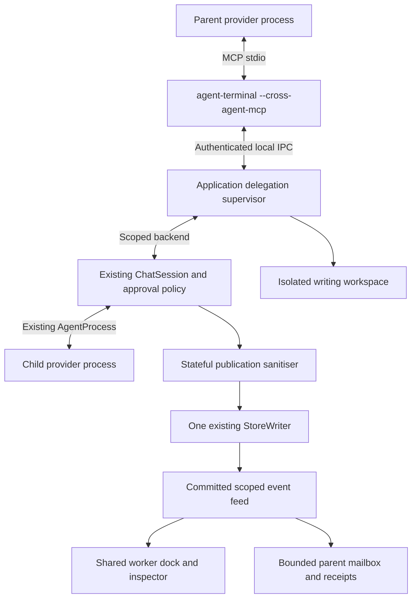
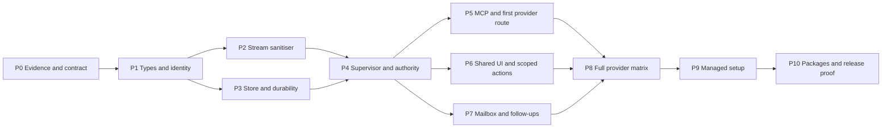

# Cross-agent runtime — detailed implementation plan

Status: reviewed and ready for P0 discovery; no implementation started.

Date: 2026-10-14. Baseline: `79304abb`, agent-terminal 3.5.0, store schema 3.

This is the implementation hand-off for the [council decision](2026-10-14_cross-agent-runtime-council.md). It makes its contracts concrete and supersedes the council document where it specifies dispatch durability, schema downgrade, API fields and work-package order more precisely. Completion means the acceptance evidence below exists; adding MCP registration or drawing a worker card alone does not complete the feature.

## 1. Product outcome and scope

A parent agent can delegate to a different provider, observe its work, send it another message, receive a question or result, and continue the same child session. The operator sees that child in the same dock and inspector as native sub-agents, with clear provider, model, effort, state and controls.

Included in the first complete release:

- The installed `agent-terminal` executable provides `--cross-agent-mcp`, dispatched before GTK/GApplication startup.
- One provider-neutral MCP API available to configured Claude, agy and Codex parents.
- Persistent worker identities; live activity, bounded results, replay, follow-up messages, stop and close.
- Shared native/cross-agent presentation and truthful capabilities. Native children receive controls only where their owning provider exposes them.
- Ordinary editable children through inherited approval limits; explicit reviewer tasks request Plan. Writing children use isolated git worktrees.
- Settings support for enabling delegation, testing, configuring, repairing and removing managed provider integration.
- Packaging and isolated-home checks for deb/rpm/Arch, using the existing release pipeline.

Proposed defaults retained from the council: complete the **in-app experience first**, and permit edits within inherited approval limits. These are stated assumptions, not answers to the earlier optional scope questions.

Deferred explicitly:

- A supervisor that runs independently of the GUI, external-terminal attachment, and surviving a GUI crash.
- Direct sibling messaging, remote agents, network listeners and arbitrary agent executables supplied through tool calls.
- Shared-tree concurrent editing, automatic merges, copying secrets/ignored inputs into worktrees, and writing delegation outside supported git workspaces.
- Replacing the existing homelab `cross-agent` PATH command or changing external agent-config/homelab-scripts deployments.
- Private chain-of-thought access or identical timing/steering semantics across providers.

## 2. Verified starting state and remaining discovery

Graphify was consulted for Store, ChatSession and agent preferences; source was then checked because graph locations are stale.

| Evidence | Verified result | Consequence |
| --- | --- | --- |
| `git status --short` | Only pre-existing `.playwright-mcp/` and council plan were untracked | Preserve them; scope new work explicitly. |
| External `cross-agent/src/main.rs`, Cargo manifest | Synchronous print/text CLI, buffered results, ephemeral read-only Codex, deployment-specific dependencies | Reuse app adapters; do not vendor that process runner. |
| Previous live `--version` checks in this session | Claude 2.1.296; agy 1.3.5; Codex 0.161.0 | Initial fixture targets; re-record if versions change before implementation. |
| `src/main.rs:47` | Approval-hook mode dispatched before GUI setup | Add headless MCP dispatch at the same boundary. |
| `agent-core/src/event.rs`, `caps.rs` | Canonical events/worker registry; live input for Claude/Codex, queued agy | Extend rather than invent parallel provider protocols. |
| `src/chat/session.rs:732` | `emit` owns persistence, state updates and the view sink; masking is currently per event | A sink-only supervisor wrapper is too late to prevent split-secret persistence. |
| `agent-kit/src/store.rs:198` | Split-delta secrets healed at snapshot/completion | Add a publication-safe child output boundary before store and sink. |
| `agent-kit/src/store.rs:474`, `store_writer.rs:23` | WAL `synchronous=NORMAL`; ordinary commit/barrier is not a power-loss durability receipt | Add a durable control-write operation before dispatch. |
| `agent-kit/src/store.rs:1745` | `schema_version` table; migrations under `BEGIN IMMEDIATE`; newer schemas refused | Use schema 4, not `PRAGMA user_version`; rollback cannot simply launch a v3 reader. |
| `src/window/imp/threads.rs:429` | Store/writer and open-thread ownership are currently app-wide thread-local state | Expose narrow app services to the supervisor; do not open a second writer. |
| `src/window/imp/closing.rs` | Window stays alive until actual process exits and writer drain | Include supervised children in those shutdown targets. |
| `src/chat/view/subagents.rs` | Existing nested inspector, retained widgets, grouped statuses and RowSink actions | One worker UI; add typed scoped actions. |
| `Makefile` targets | `make check` runs lint, isolated nextest, ignored display tests and QA unit tests | Extend registered targets; never hand-run a test script. |

Discovery must settle these claims before implementation commits freeze the public contract:

| Gate | Required experiment and artifact | Stop condition / fallback |
| --- | --- | --- |
| D1: parent binding | Launch each CLI with a fake local MCP server in an isolated home; capture initialise/list-tools/call, environment inheritance, name precedence and restart behaviour | Never infer parent identity from task text, current tab or a global config. Refuse an unbound route. |
| D2: provider registration | Prove Claude launch overlay; Codex launch override; identify every agy MCP discovery source and any safe override | If agy requires persistent registration, prove precedence and absolute managed command verification. No home-copy workaround. |
| D3: invocation correlation | Capture native MCP call IDs and bridge request IDs; prove linking when available | Worker still works through the authenticated principal if exact call linking is absent; keep the generic call card as an ordinary linked/unlinked control action, never invent a second worker. |
| D4: model/effort | Record requested alias, launch settings, reported model, fallbacks and effort evidence | Missing evidence is `unknown`/`launch_configured`; do not block a valid run merely because provider-confirmed effort is absent. |
| D5: delivery | Busy/idle child and parent; Codex turn-end race; agy next-turn queue; source attribution | Immediate delivery only where proven. Durable mailbox and explicit wait remain universal. |
| D6: safety | Child Ask edit allow/deny, Plan refusal, environment/profile changes, agy hook proof in actual worktree | Refuse the combination if requested authority cannot be enforced. |
| D7: lifecycle | Turn completion, bridge disconnect/reconnect, nested stop, root Stop, window transfer | No phantom finished/running state and no cross-root control. |
| D8: SDK/build | Pin an official Rust MCP SDK release compatible with Rust 1.89, supported targets and stdio; review dependencies and licensing | If SDK needs Tokio, confine it to the headless bridge process. Preserve the app's GIO process runtime. No GTK floor increase. |

Fixtures live under proposed `tests/fixtures/real/delegation/<provider>/`; fake process fixtures under `tests/fixtures/delegation/`. Store only scrubbed frames, version metadata and deterministic fake credentials. Put temporary recordings/screenshots under ignored `target/delegation/`.

## 3. Architecture, ownership and code map



The supervisor is held by application services, not a tab, shelf or dialog. It references the root session/lineage and uses weak UI subscribers. Moving a root between windows rebinds the subscriber; it neither launches nor duplicates the root or children. Child sessions are built without top-level pages or terminal drawers.

| Location | Responsibility / planned changes |
| --- | --- |
| `crates/agent-core/src/delegation.rs` and focused submodules | Pure protocol types, IDs, authority predicates, lifecycle/dispatch/mailbox reducers and limits. Export through `lib.rs`. |
| Proposed `crates/agent-core/src/redact/stream.rs` or equivalent sibling module | Stateful publication sanitiser sharing existing complete-string rules. Retain the public redaction interface. |
| `crates/agent-core/src/event.rs`, adapters, `caps.rs` | Additive worker identity/provenance and verified capability mappings. Do not equate a transport progress message with a worker event. |
| Proposed `crates/agent-kit/src/store/delegation.rs` | Typed store queries/transactions, schema 4 additions and event-link queries; reuse parent store connection. |
| `crates/agent-kit/src/store_writer.rs` | Durable control operations, committed receipts and bounded admission; preserve the single writer. |
| Proposed `src/delegation/{mod,supervisor,ipc,mailbox,workspace}.rs` | App-owned orchestration, authenticated local endpoint, child lifetime, queues and worktree preparation. Split files when needed rather than growing `session.rs` with an entire second runtime. |
| Proposed `src/cross_agent_mcp.rs` | SDK-backed stdio facade translating fixed tools into IPC. No database or child process ownership. |
| `src/chat/session.rs` and focused submodule | Typed delegated input with receipts/source; inherited authority before auto-allow; safe child publication before persistence; preserve hook/canary and generation machinery. |
| `src/agent_proc.rs`, `src/agent_home.rs`, `src/codex_home.rs` | Scoped launch environment and observed exit handling. Never expose delegation capability through logs or argv. |
| `src/window/imp/threads.rs`, `closing.rs`, app startup | Narrow services for store/session factory/hook checks, hidden child exclusion, transfer, stop and writer drain. Avoid broad ownership refactor. |
| `src/chat/view/{model,subagent_shelf,subagents}.rs`, `cards.rs`, `view.rs` | One worker model and inspector; typed child controls, scoped approvals/questions/forms/diffs and metadata provenance. |
| `src/config.rs`, agent preferences and proposed managed-config helper | Stable profile IDs, user delegation settings, integration health and atomic installation/undo. |
| `Cargo.toml`, `Cargo.lock`, `THIRD_PARTY.md`, package manifests, Makefile/QA | Coordinator-owned dependency/package integration and registered checks. |

Reuse GIO and current policy directly. A new GTK-free runtime crate is deferred until there is a real second consumer. SDK dependencies are build dependencies of the shipped executable, not additional installed services or separately downloaded runtimes.

### Session input and event routing

1. A new typed `DelegatedInput` carries source principal, message ID, intended worker/run, delivery policy and redacted bounded content. Do not implement it by calling `send_prompt`/`steer_prompt` unchanged: those currently model user messages and return no delivery receipt.
2. Keep original native request IDs inside each adapter for replies. UI IDs are scoped by worker and process generation; turn-targeted requests also carry run ID.
3. Feed child events into a child transcript scope. A child's `TurnCompleted`, `SessionExited`, usage or model change must never end the root turn, replace the root model or change its account indicator.
4. Introduce a typed outer `ScopedEnvelope` / `Transcript::apply_scoped` boundary. It routes child content into child submodels and worker registry updates into the root's existing worker presentation. Source identity comes from the supervisor.
5. Persist authoritative child events once in their backing thread; use event links for root aggregate reads. Do not duplicate every child token as root-thread event rows. Root lifecycle/worker summaries may be stored as their own canonical events.
6. Existing provider-native workers retain current mappings. Add alias records only where native identity is confirmed; unavailable native controls stay unavailable. The root principal itself does not appear in the child dock/count.

**Atomic visibility:** append each authoritative child event and all required event links/state updates in the same writer transaction. Publish the committed event/cursor only after that transaction; never queue links in a later job. A root reader cannot advance past an event whose membership will appear later. Alias resolution normally appends a fresh registry/snapshot event and affects future events. If historical relinking is required, do the entire backfill and a root stream-epoch change in one transaction; invalidate every previously issued aggregate cursor with explicit resynchronisation. No silent membership insertion behind a valid published cursor. P3/P4 tests must delay a child link/alias while another event advances the reader and prove that loss is impossible.

## 4. Fixed API v1

The bridge negotiates MCP normally; its own control contract has independent `api_version: 1`. Version compatibility is checked during IPC handshake and returned by capabilities. Schemas are checked into the repository and exercised against the implementation; no separate hand-maintained provider schemas.

Common rules:

- `worker_id`, `run_id`, `message_id` and operation IDs are opaque application handles, never native IDs.
- A root is represented by a root worker/principal handle with no parent; tools obtain the caller principal from authentication. `target: "parent"` resolves server-side.
- Mutating requests carry an idempotency key and `expected_authority_epoch` obtained from capabilities/a prior receipt. This is a concurrency fence, never a caller-supplied identity or permission grant. Repeated key + identical canonical request returns the existing operation. Changed input yields `idempotency_conflict`. Keys are scoped to principal/epoch/operation; receipts include that scope. A stale epoch is rejected rather than interpreted as a new operation. Reconnecting with a new authority epoch must not silently replay an old request under the new epoch.
- Never accept arbitrary executable, shell string, environment, parent identity, socket path or token in model-generated tool arguments.
- Tool execution failures return stable structured error content with `isError`; malformed protocol requests use MCP protocol errors. Text fallback accompanies structured results for clients that ignore `structuredContent`.
- Receipt acceptance does not claim that a model consumed the message or that external edits ran exactly once.
- `read` is normally observational. If it includes `acknowledge`, it also requires `idempotency_key` and `expected_authority_epoch`, uses the durable mutation path and reports the acknowledgement result separately from its page. Retrying an ACK can never implicitly consume newer notifications.

| Tool | Request fields | Result / behaviour |
| --- | --- | --- |
| `cross_agent_capabilities` | Optional `profile_id` | Contract version, caller handle/epoch, usable profiles, models/efforts/provenance, delivery/control capabilities, limits and verified/unverified/unsupported route status. No environment values or capability tokens. |
| `cross_agent_spawn` | `profile_id`, `name`, `task`, `task_mode: ask\|accept_edits\|plan`, optional `model`/`effort`, `workspace`, `idempotency_key` | Quick accepted operation/worker handle, queued/starting state, requested identity and effective authority summary. Model confirmation arrives later. Unavailable/unsafe launches fail visibly. |
| `cross_agent_send` | `target: worker_id\|parent`, `text`, `kind: instruction\|report\|question\|reply`, optional `reply_to`, `delivery: auto\|this_run\|next_turn`, optional `expected_run_id`, `idempotency_key` | Message/operation handles and receipt. `this_run` requires a matching live run and supported steering; never silently moves to another run. `auto` may explicitly report `queued_next_turn`. |
| `cross_agent_read` | Target or own mailbox, optional `after`, `max_events`, `max_bytes`; optional `acknowledge: [{message_id, recipient_run_id}]` | Snapshot, bounded events/messages/results, receipts and next cursor. No implicit acknowledgement. Invalid/out-of-scope ACK fails without consuming other messages. |
| `cross_agent_wait` | Worker set and/or own mailbox, optional `after`, `timeout_ms`, response bounds | Wait for any relevant event/state/message after cursor; return data or `timed_out: true`. Timeout never stops workers or means failure. Disconnect releases wait resources only. |
| `cross_agent_list` | Optional subtree target, pagination cursor, limit | Caller-authorised descendants; exclude other roots and unauthorised ancestors. |
| `cross_agent_cancel` | Worker, optional expected run, `idempotency_key` | Stop current targeted run and its descendant runs, initially `stopping`, terminal after observed exits. Retain reusable worker. Wrong generation cannot stop a newer run. |
| `cross_agent_close` | Worker, `idempotency_key` | Permanent closure of worker/subtree; revoke capabilities, invalidate queued operations, observe exits, preserve transcript. Caller cannot close its ancestor through this tool. |

`kind: instruction` is allowed from parent to child only. Child-to-parent reports/questions/replies are labelled delegated data and cannot impersonate a user instruction. Reject unsupported direction/kind combinations.

Example spawn (illustrative profile/model IDs; not executable installation configuration):

```json
{
  "profile_id": "profile-codex-review",
  "name": "Parser reviewer",
  "task": "Review parser error handling and report concrete findings.",
  "task_mode": "plan",
  "workspace": {"kind": "shared_read_only"},
  "expected_authority_epoch": 4,
  "idempotency_key": "review-parser-1"
}
```

Example receipt:

```json
{
  "api_version": 1,
  "worker_id": "worker-opaque",
  "operation_id": "operation-opaque",
  "authority_epoch": 4,
  "state": "accepted",
  "identity": {
    "driver": "codex",
    "model": {"requested": null, "effective": null, "source": "unknown"},
    "effort": {"requested": null, "effective": null, "source": "unknown"}
  }
}
```

Stable errors include `runtime_unavailable`, `provider_unavailable`, `route_unverified`, `protocol_incompatible`, `unsupported_delivery`, `unsupported_effort`, `authority_denied`, `approval_required`, `quota_exhausted`, `capacity_reached`, `idempotency_conflict`, `stale_epoch`, `stale_run`, `cursor_expired`, `worker_closed`, `deadline_exceeded`, `persistence_failed`, `delivery_unknown` and `transport_lost`.

### Initial bounded defaults

| Limit | Initial proposal |
| --- | --- |
| Active runs | 4 per root, 8 app-wide; native activity reported where known, no claim to control external native spawning |
| Live supervised processes | 8 app-wide including idle reusable processes; a new child fails/queues when full, and an idle child resumes on its existing process without needing a second process slot |
| Delegated depth | 2 edges below the root; children at the ceiling get no spawn authority |
| Pending starts | 32 per root, 64 app-wide; capacity returned immediately when full |
| IPC frame | 1 MiB maximum before parsing; tool-specific text bounds below this |
| Task/message | 64 KiB task, 16 KiB message; reject over-limit requests with a clear bound |
| Read/wait page | Default 100 events / 64 KiB; hard maximum 500 / 256 KiB |
| Long wait | Default 10 s, hard maximum 30 s; no blocking main-thread wait |
| Run deadline | Default 15 minutes, bounded profile setting; distinguish provider wait from run timeout |
| Automatic root continuation | One reserved continuation at once; maximum 3 automatic turns per active root task |
| Uncertain sanitiser buffer | 64 KiB per active stream plus aggregate per-root bound; withhold/mask on overflow |

These are product defaults, to tune from measured fixtures. Count descendants consistently. A completed turn releases a run slot but its live idle process still consumes a process slot; only an observed process exit releases that slot. Continuation reacquires a run slot and, if it must respawn, a process slot. Bound aggregate bytes, active streams, idle open sessions, subscribers and wait requests as well; page limits alone do not bound memory or storage. Set explicit caps in P0 before activation, with expiry/disconnection responses that leave durable history readable.

## 5. Data model, transactions and durability

Use the existing database, writer, threads, provider threads and `events.seq`. Proposed schema 4 adds these tables; final SQL constraints/indexes are frozen in P0/P3.

| Table | Essential fields / invariants |
| --- | --- |
| `delegation_roots` | Root thread FK, root worker ID, persisted task state `active/stopped/closed`, authority epoch/policy revision, stream epoch, sanitised policy JSON, continuation budget/reservation. No bearer capabilities. |
| `delegation_workers` | Opaque ID; immutable root/parent FKs; origin `root/native/supervised`; profile ID plus launch snapshot; optional unique backing thread; session state; workspace descriptor; identity/provenance; timestamps. Root has no parent. |
| `delegation_runs` | Run ID, worker FK, process generation, optional provider thread/native turn, authority epoch, run state, terminal reason and usage. At most one active run per worker, enforced by constraint/transaction. |
| `delegation_operations` | Operation ID, principal/root/epoch, kind, idempotency key, canonical fingerprint, target/run, accepted/dispatch-reserved/submitted/confirmed/failed/unknown state, bounded scrubbed result/error. Unique principal+epoch+kind+key. |
| `delegation_messages` | ID, operation FK, sender/recipient handles, reply correlation, scrubbed body/kind, intended run/delivery policy, queued/submitted timestamps, receipt acknowledgement and optional provider confirmation as separate facts. |
| `delegation_event_links` | Composite key `(event_seq, worker_id)`; event FK, root/worker/run, event category and optional attested invocation ID. Many-to-many links handle a native registry event naming several workers. Query distinct events for aggregate pages. |
| `delegation_native_aliases` | Unique `(provider_thread_id, process_generation, native_worker_id)` → application worker handle. No identity matching by name. |

Create root policy and root worker in one transaction: `delegation_roots.root_worker_id` is non-null with a deferred FK to workers, so insert the root row followed by its root worker and check both links before commit. The worker's root FK then resolves to the already inserted root. Test deferred-FK rejection of partial roots. Backing threads for supervised children are excluded explicitly from root sidebar/open-thread restoration/native import queries. Root threads remain visible. Deletion first closes/revokes live descendants; FKs prevent dangling event/message links. No retention job deletes active operation/idempotency history.

Store only scrubbed text/policy and safe profile metadata, never secret values or full environment snapshots. A fingerprint must not retain a recoverable secret or become a weak unsalted hash oracle: use the validated scrubbed request as the dispatched input and fingerprint that canonical representation. For fields where scrubbing changes the meaning of a permission request, keep the existing deny-only UI policy rather than dispatch a modified action.

### Write protocol

1. **Accept:** on the single writer, validate current persisted authority/capacity and idempotency; create operation, worker/message, optional run reservation and audit event atomically. Return only after the required durable commit.
2. **Reserve dispatch:** commit a dispatch reservation for the exact input/run/epoch before process creation or pipe write. This is the point after which recovery is conservative.
3. **Dispatch:** return to the supervisor's GIO context; immediately recheck its current revocation epoch/closing state, then launch/write without yielding between check and action. Native provider execution is outside the SQLite transaction.
4. **Record submission/confirmation:** persist observed transport/provider facts separately. Never translate pipe-write success into model-consumed.
5. **Complete:** terminal run state, bounded result, completion mailbox notification and terminal event/link commit together. Publish resumable terminal state after that commit.
6. **Revoke:** immediately mark root/lineage stopping in memory so no new action can slip through; durably advance epoch and invalidate queued dispatch/approvals/continuations atomically; then interrupt/reap processes. If persistence fails, remain stopped in memory, terminate unsafe work and report persistence failure. Recovery never restarts these runs automatically.

An ordinary `StoreWriter::write` is queue acceptance; `call_result` waits for commit; neither currently proves power-loss durability under `NORMAL`. Add a distinct `durable_call`/control operation on the **same writer**. Drain/commit its normal batch, set `synchronous=FULL` outside a transaction, run and commit the control transaction, then restore the prior mode before ordinary batching resumes. A failed commit/durability setup refuses dispatch. Verify actual pragma values and restoration; do not mix durable and normal jobs in one unacknowledged batch. Evaluate batching multiple control reservations together where it preserves semantics; do not fsync every token event.

This targets process-crash and standard SQLite WAL/FULL durability semantics, subject to filesystem/hardware guarantees. It does not make external commands or edits exactly once. If process crash, transport loss or power loss makes dispatch ambiguous, recovery returns the existing operation as `delivery_unknown`; it never retries that external action automatically. Accepted-but-never-reserved operations can be explicitly resumed only after epoch/capacity revalidation.

Ordinary stream events may retain the existing NORMAL durability level; a subsequent durable control commit includes preceding WAL content. After an abnormal restart, use a new stream/session epoch so an old cursor cannot silently skip rolled-back tail events or be reused against newly allocated sequence numbers.

### Replay and schema rollback

- Cursor contains root, stream epoch and `events.seq`; clients treat it as opaque. Reads are authorised and ordered by committed sequence, with explicit gap/epoch mismatch. Acknowledging a report is a separate durable operation.
- Live provisional UI text is allowed after sanitisation but labelled/treated separately from committed replay. Durable pages/receipts cannot reference uncommitted events.
- Migrate a disposable v1/v2/v3 store to v4; verify original threads/events/refs, FK integrity, retry and partial-migration rollback. Never run migration experiments on the user's live store.
- **Additive schema does not imply binary downgrade compatibility:** the old code refuses schema 4. Do not decrement the version number or drop tables to force it open.
- Before migration, run a bootstrap preflight **before `Store::open`**, which currently migrates immediately. Open an existing database without invoking migration, inspect its schema and create a coherent SQLite backup through the SQLite backup API (enable rusqlite's backup feature if needed). On startup there must be no app writer yet; an in-process migration first drains/stops its writer. The backup API must produce a coherent snapshot even with WAL/external readers. Copying only the main file is invalid. Verify backup integrity/schema and restrictive directory/file permissions before migration; on failure leave the original schema untouched and refuse delegation activation. Include disk/size/error handling and retain the backup privately.
- Make preflight part of the real open/startup path, not an optional setup action: serialise upgrade openers with a private advisory upgrade lock, take SQLite's write reservation before the final version recheck, and hold concurrent writers out until the verified preimage and migration decision are complete. A separate read-only backup source can read the reserved, unmodified database; validate the exact backup/lock sequence against rusqlite/SQLite in P3 rather than attempting backup from a source connection with an open write transaction. Perform migration under that ownership without a release/reacquire gap, adapting `migrate_in_txn` to accept the reserved transaction. If this sequence cannot be proved, refuse upgrade rather than weaken backup ordering.
- Publish backups under unique private names with source identity/schema/time and no-clobber creation. A concurrent opener rechecks schema after taking ownership; if already v4, it must reuse/retain the original backup record and never overwrite it with a v4 snapshot. Backup failure rolls back/releases the reservation without a schema change. Test concurrent openers, an active WAL writer, failure before/after backup verification and restart through the actual open path. A pre-upgrade running app instance must be excluded by normal application ownership before migration; an unexpected incompatible owner is an error, not a permission to migrate under it.
- Preferred rollback is disable delegation while retaining a schema-4-compatible binary. Full binary downgrade requires an explicit verified backup/export procedure and disclosure of any newer history excluded; never silently replace a newer store with the old backup. P3 must document and test that path before merge.

## 6. Authority, IPC and workspace rules

An `InheritedAuthority` contains root/parent handles, epoch/policy revision, canonical workspace scope, safe mode ceiling, approved resource/tool predicates and delegation limits. Effective authority is a deny-first predicate intersection; it is not an ordering of Mode enum discriminants.

- Enforce it before Always/session-rule auto-allow for every provider, including the agy hook path. Validate actual child home/cwd/profile when checking hooks. Each child gets its own approval endpoint and delegation principal.
- Bypass never propagates. A child in Ask may ask the operator to approve an edit. A spawn permission is not blanket approval of all child tools.
- An inherited file/folder grant never silently changes meaning in a worktree. Resolve and explain the precise resource/workspace boundary before offering any remembering button.
- An isolated workspace gets a typed lease linking canonical source repository, permitted relative source paths, concrete child worktree and base. The supervisor creates/attests this lease after checking the parent's repository authority. Evaluate source containment **and** physical worktree containment, symlink resolution and sensitive-file checks. Root Accept edits may apply to ordinary allowed source paths materialised in that lease; an absolute saved/session grant for the original tree is not copied to the child path. Extra repositories/out-of-scope source paths require a new authority decision. Store the lease and surface its exact workspace on approvals so the intersection is enforceable rather than a contradictory pair of unrelated absolute roots.
- Parent restriction/Stop invalidates outstanding child approvals and queued turn-starting messages. Widening a root setting does not widen existing children; that requires an explicit new authority decision.
- Keep trusted raw approval arguments inside the session policy path, separate from sanitised publication. Masked/changed requests remain deny-only when the app cannot show exactly what would be granted.
- Child providers, profiles, commands and environments are selected from validated configuration; model tool inputs cannot supply arbitrary spawn specs.

Prefer a private Unix-domain socket under the app's runtime directory. Handshake checks contract version, random app-instance nonce, random per-launch bearer capability, socket ownership and peer credentials where supported. Verify scope on every operation. Bound frames before allocation/parsing. No TCP or unauthenticated fallback to the active window.

Capabilities and endpoints are passed through scoped launch environment/private channels, never argv or persisted MCP config. Strip inherited delegation/approval variables before installing the new child's own values. Do not log resolved command arguments, tokens, prompts, frame bodies or environment files. A same-UID bearer authenticates the delegated launch principal; it is not a sandbox against malicious shell code or independently verified native descendants inheriting that principal.

Writing workspace policy:

1. `shared_read_only` uses the parent's actual tree only with proven provider read-only enforcement.
2. `isolated_worktree` names an explicit committed base and creates a child worktree through existing helpers. Show the base and state that parent dirty changes are absent.
3. If the task requires dirty inputs, offer an explicit snapshot base only after the existing private-index/checkpoint privacy invariants have been proved for materialisation. Exclude secret-looking/ignored inputs, disclose omissions and refuse tasks requiring unavailable inputs.
4. Each writer has its own tree. The parent can continue editing its own tree. Diff/approval/checkpoint/undo controls resolve against the child's tree.
5. Applying child work is a separate reviewable integration action with baseline/conflict checks and an undo checkpoint. V1 can expose the existing diff/external-tool path plus explicit integration; do not auto-merge when a child finishes.
6. Cleanup is offered only after closure, only for a clean worktree with no open user tab, using non-forced removal and leaving the branch. A dirty worktree stays visible as retained work, not leaked cleanup debt hidden from the user.

## 7. Streaming, recognition and communication

### Publication sanitiser

State is keyed by worker + process generation + item + stream. It shares existing recognised credential/key/PEM rules, preserves Unicode boundaries and withholds incomplete candidate content. It can emit conservative masked text or safe snapshots when incremental correctness is uncertain. Hold all relevant text/raw copies until safe; dropping a raw debug fragment is preferable to leaking it. Preserve the existing complete-string redactor's documented detection limits.

Test every split of representative recognised credentials, multiple split positions, Unicode boundaries, interleaved workers/streams, malformed JSON, huge unterminated lines, snapshots replacing deltas, completion, cancellation, process loss and reconnect. Join all published chunks and all stored chunks in the assertion. Overflow flushes no uncertain bytes; it produces an explicit withheld/truncated notice. Approval authority uses original trusted inputs rather than the sanitised replacement.

Do not inherit the current writer's exceptional force-admission for secret healing as the new flow-control policy. New child content has bounded queues. Coalesce replaceable snapshots; reserve bounded capacity for terminal/error/approval/message events. On exhaustion, stop or pause affected intake/worker safely and surface an error. A blocked provider may not make main-loop progress wait on disk or another subscriber.

### Worker recognition and UI

- A supervised spawn creates the worker in the runtime registry before its accepted response; the registry is the source of identity, not a `cross_agent` tool-name regex.
- Runtime-attested invocation mapping links the generic MCP operation to its child. Suppress only redundant presentation when the match is proven; keep debug/access to the underlying control call.
- Child-specific colour/icon/text come from child provider identity, never root driver. Model and effort each show requested/effective value plus `provider_reported`, `launch_configured`, `unknown` or `unsupported` provenance.
- Existing native workers appear alongside supervised workers and keep unknown fields/capabilities when not provided. No fake Stop/Send buttons on historical or uncontrollable native workers.
- Typed `WorkerAction`/RowEvent carries worker, run/generation and scoped request handle. Route approval, question, form and diff actions through the supervisor's child backend. Two children may safely reuse native request ID `1`.
- Inspector shows task, identity, last activity/time, nested transcript, permissions, files/diff, messages/receipts and result. Current step updates are coalesced; large history builds lazily. Text remains selectable, controls keyboard-accessible and identity is understandable without colour.
- Finished workers remain docked under the current turn/dismiss policy and inspectable in history. Dismiss is visual only. Stop cancels a run; Close ends a session; neither destroys stored output.

### Message protocol

Message lifecycle records accepted, queued, dispatch-reserved, submitted, provider-confirmed when supported, failed/cancelled/unknown. Receipt acknowledgement is separate. Reports/questions/replies carry stable causality IDs and source labels. User-entered inspector messages carry human source; agent-authored reports never masquerade as human messages.

| Situation | Action |
| --- | --- |
| Running Claude child, `auto` | Use existing live input only after typed dispatch reservation; report submitted unless a provider acknowledgement is available. |
| Running Codex child, `this_run` | Use `turn/steer` pinned to run; stale/refused steer reports race/failure, without silently starting another turn. |
| Running Codex child, `auto` | On a refused steer, record an explicit queued-next-turn transition before dispatching the next turn. |
| Running agy child | `auto` queues next turn; `this_run` returns unsupported. Never restart merely to simulate live delivery. |
| Open idle/completed child | Start a new run on the same child/native session, after capacity/epoch checks. |
| Child asks/reports to parent | Persist mailbox entry and notify UI/wait subscribers. The parent can reply with `reply_to`; the child receives the correlated reply through the same delivery rules. |
| Parent waiting | Return bounded mailbox changes/results promptly; no implicit ACK. |
| Parent busy/approval pending | Use proven safe boundary or queue; never answer/interrupt an approval with child text. |
| Parent idle and root active | Reserve at most one source-attributed automatic continuation, subject to the persisted 3-turn budget. Batch pending reports, avoid circular wake-ups and never replenish budget from child reports. |
| Root stopped/closed | Queue remains inspectable; reject automatic continuation and late turn-starting operations. |

Completion/error/input-required notifications are durable and coalesced. Detailed child token streams stay in the inspector; parents get bounded reports/results and can inspect on demand. UI notification remains visible even if a provider lacks asynchronous wake-up. Repeated read/wait calls do not consume or repeatedly inject a report.

## 8. Installation and configuration

Package installation provides the MCP mode automatically. Provider registration is managed in Settings, with no package post-install script modifying home directories and no external cross-agent download.

1. Add stable opaque profile IDs to persisted config. Migration assigns missing IDs once, preserves them on rename/reorder, rejects duplicate IDs and saves atomically. Do not address multiple same-provider profiles by driver or display name alone. IDs are configuration identity, not authentication tokens.
2. Add an application Cross-agent group and per-profile `Available for delegation` setting, separate from enabling a profile for normal threads. Proposed default disabled until Configure/Test succeeds; this is a user capability setting, not a deployment feature flag.
3. Display independent facts for binary availability, authentication, MCP registration and live app binding. Summarise readiness as Ready / Not configured / Could not verify with specific reasons; a stale success is never healthy by default.
4. Prefer launch overlays for app-launched sessions, merging with unrelated existing tools. D2 determines provider-specific implementation; do not invent agy override support.
5. Where persistent registration is necessary, parse actual source/precedence, verify managed command ownership, show a redacted change preview and preserve unrelated JSON/TOML content/comments where applicable. Refuse unreadable/corrupt/conflicting/concurrently changed files.
6. Atomically write with restrictive permissions, sync and rename; record preimage/postimage hashes and the owned edit for undo. Keep backups private; they may contain unrelated secrets and must never enter the thread store or logs. Never pass credentials in command arguments.
7. Test performs MCP initialise + list-tools + authenticated capabilities through the exact configured profile/environment. A fake child diagnostic tests launch, terminal event and shutdown without consuming provider quota; real provider verification is a separate recorded fixture/smoke.
8. Repair uses the same diff/validation path; Remove affects only the managed entry. Both remain available for broken registrations. Undo refuses to overwrite subsequent user edits and instead presents the remaining diff.
9. Persisted command uses the absolute installed `agent-terminal --cross-agent-mcp`. Endpoint/capability is inherited at launch. Outside the app return actionable `runtime_unavailable`, not attach to whichever window happens to be open.
10. Existing external `cross-agent` names/configuration are a visible conflict, never automatically replaced or deleted. Provider installation/authentication uses existing detection/help paths; this feature adds no new updater/network installer.

## 9. Implementation work packages and dependencies

All paths below are proposed ownership lanes. Builders get only their lane plus the frozen contract. Coordinator owns lockfile, shared integration, schema sequencing, commits, review verdicts and release actions. Use protected-branch PRs; parallel editing requires separate worktrees. Read-only reviewers can share the checkout. No jobs are posted or implementation branches created by this planning task.



P5/P6/P7 may proceed in parallel only after their interfaces are frozen. The first route becomes usable only when all three integrate safely. Setup UI design can be prepared earlier, but provider registration cannot be called ready before P8.

| Package | Owned scope and concrete tasks | Required proof / rollback |
| --- | --- | --- |
| **P0 — discovery and binding contract** | Scrubbed fixtures; D1–D8; freeze tool schemas, identity/authority/receipt models, limits, root wake policy, worktree base rules and downgrade procedure | Review contract against all clients; resolve agy binding/enforcement. Revert docs/fixtures only; no live config edits. |
| **P1 — pure types and identity** | `agent-core/delegation*`, additive event/capability types; stable profile IDs in config through coordinator; version/error/namespace/state reducers | Round-trip/unknown-version tests, exhaustive capability arrays, root/native/supervised IDs and stale-run cases; config migration/rename/reorder/duplicate-ID tests. No tool exposed yet. |
| **P2 — publication sanitiser** | Streaming redaction module plus narrow pre-persistence child hook in session; safe raw handling and bounds | Fragmentation/interleaving/overflow/cancel/reconnect tests pass before any live child text. Revert integration while children disabled; retain existing root behaviour unless deliberately covered. |
| **P3 — schema and durable control writer** | Store v4 tables/queries, `durable_call`, typed operations, atomic event+link publication, mailbox ACK transactions, hidden child queries and pre-migration startup backup | Real open-path/concurrent migrations and no-clobber backup, FULL/normal restoration, injected commit/durability failure, dispatch uncertainty, delayed-link/alias cursor regression, replay epoch and writer overload. Schema rollback procedure tested; code revert alone is insufficient after migration. |
| **P4 — supervisor and authority** | App service, child session factory, typed input receipts, epoch enforcement, profile environment, checked agy hook, source-to-worktree authority lease, atomic event/link submission and observed-exit registration | Fake-process launch/approval/cancel/close/Stop/restriction races; separate run/process capacity accounting; narrow relative versus external absolute/sensitive worktree grants; delayed-link cursor safety; no cross-root control; child turn cannot alter root state. Disable admission and close through normal supervisor for rollback. |
| **P5 — MCP/IPC and first route** | Headless dispatch, SDK facade, authenticated bounded local IPC, scopes/revocation and launch injection. First live route: Claude parent → Codex child | No-display initialize/list-tools; missing/expired capability errors; reconnect keeps worker; spawn/read/wait/send/cancel with a real tool event. Disable launch integration to roll back; preserve child history. |
| **P6 — shared worker UI** | Scoped transcript reducer, same shelf/inspector, identity provenance, typed controls, child approvals/questions/forms/diff and hidden-child navigation | Construction/scripted/display checks; two children reuse request IDs; correct child worktree diff; long/unknown identity; keyboard/focus/selection; parent model/status unaffected. Roll back view only with controls disabled. |
| **P7 — mailbox and continuation** | Typed reports/questions/replies, durable ACK/receipts, safe-boundary send, `this_run` vs auto fallback, bounded idle-parent continuation | Busy/idle matrix, duplicate/conflicting keys, lost ACK, root Stop wins queued wake, finite loop budget, same child second turn. On rollback stop automatic dispatch and leave messages readable. |
| **P8 — provider/native parity matrix** | Remaining parent/child launch mappings, agy queue/hook handling, native aliases/control capabilities, model/effort provenance/fallback, nesting/window transfer | All 9 directed pairs, six cross-provider routes; two-turn follow-up; safe Plan/Ask; mixed native/supervised workers; bridge loss/root closure. Unverified routes remain explicitly unavailable. |
| **P9 — managed setup and installation** | Preferences/config helper, per-profile enablement, Configure/Test/Repair/Remove, registration precedence/conflicts/private rollback, docs | Fresh/corrupt/changed/conflicting isolated homes; idempotent repeated setup; selected env/account; absolute installed path; outside-app failure; existing external CLI preserved. Undo checks postimage before restoring. |
| **P10 — hardening, packages and release** | Flood/soak/limits, database recovery, package headless smoke, all asset lists, release docs/version/CI integration | `make check`, package dry runs and live preview evidence; fresh cross-harness security/contract review; final go/no-go. Ship only via git → CI packages. Disable capability using a schema-compatible binary if rollback needed. |

Review-sized splits are acceptable within a package; do not reorder around its safety prerequisites. No arbitrary schedule is promised before P0 resolves provider configuration and authority enforcement. Critical path is P0 → pure contract/sanitiser + persistence → supervisor → complete route → provider matrix/setup → release proof.

## 10. Acceptance matrix and verification commands

Each cell in the provider matrix needs the same evidence bundle: version/config metadata, worker identity, streamed tool step before completion, parent result, two turns on one worker, message receipt, cancellation, child-attributed approval where supported and replay. Same-provider routes are controls, not substitutes for cross-provider proof.

| Parent ↓ / child → | Claude | agy | Codex |
| --- | --- | --- | --- |
| Claude | Pending | Pending | First complete route |
| agy | Pending | Pending | Pending |
| Codex | Pending | Pending | Pending |

| Test family | Required regressions |
| --- | --- |
| Protocol and metadata | Unsupported/mismatched versions, unknown fields, invalid delivery, requested/reported/configured-only/unknown/unsupported identity, fallback updates, native unknown capabilities, no root-brand leakage |
| Dispatch/durability | Same key same request; changed request; crash before intent, after reserve, after pipe write, before ACK, before result notification; failed FULL commit/restore; unknown outcome never re-executes |
| Authority | Parent Ask allow/deny; Plan enforcement; no Bypass inheritance; stale approval/generation; Always rule cannot bypass inherited scope; sensitive files; selected home/worktree hook proof; narrowing/Stop race |
| Message causality | Question/report/reply IDs, parent busy/idle/waiting, child busy/idle, agy queued, Codex turn race, unsupported strict steering, plain read vs ACK vs provider consumption, bounded auto-wake budget |
| Scoped UI | Child turn/model/usage cannot replace root; repeated native IDs across workers; correct child diff/base/undo; selectable long text; keyboard controls; narrow window; worker history remains inspectable |
| Lifetime | Parent turn completes first, shim reconnect, child resume, cancel versus close, unknown after restart, window transfer, closing window and app, process-group limitation shown honestly |
| Workspace | Isolated writers while parent edits, dirty base disclosure/snapshot exclusions, conflict-safe integration and undo, no user-index/HEAD changes, no forced cleanup or deletion through symlinks |
| Streaming/security | Every credential fragmentation, Unicode/interleaving/raw copies, huge uncertain content, cancelled incomplete item, forged worker JSON/tool names, out-of-scope token/handle, oversized frames, no credentials in logs/config |
| Resources | Slow store, slow inspector, slow parent, reader reconnect/gap, event flood, many waits/streams/open sessions, queue refusal, bounded snapshot coalescing and terminal-event delivery |
| Setup/packages | Isolated homes for all providers; missing/corrupt/conflicting/concurrent config, rename/reorder profile IDs, repeat configure/repair/remove, private backup rollback, headless binary with no display, old external CLI untouched |

Use pure tests for types/reducers/sanitiser, real SQLite/temporary-git tests in agent-kit, fake-process scripted tests for runtime/permissions, and existing GTK construction/display tests for UI. Register any new QA suite in Makefile/CI rather than asking developers to invoke its script directly. Real provider runs are isolated, short and fixture-driven; routine tests consume no quota and make no network calls.

Baseline commands, one command per shell invocation:

1. `cargo test -p agent-core`
   Expected: pure protocol/redaction tests pass without a display.
2. `cargo test -p agent-kit`
   Expected: store/migration/idempotency/temporary-git tests pass without touching user state.
3. `make test`
   Expected: existing isolated test runner plus new registered scripted cases pass.
4. `make check`
   Expected: fmt/clippy/no-default-features check, all tests, serial ignored display tests and QA unit tests pass.
5. `make coverage`
   Expected at final verification: current coverage floor holds; do not lower it to accommodate the feature.

During implementation run only checks appropriate to each package; the final full gate is required. Never run cargo mutants locally. Live GUI interaction goes exclusively through `preview_app` with isolated XDG homes/D-Bus, the debug binary and fixture workspace; never kill or activate the user's packaged instance. Use existing packaging container workflows for deb/rpm/Arch dry runs and no-display MCP smoke, not `make install`.

Record results in proposed `docs/qa/cross-agent-runtime.md`, linking scrubbed fixtures and ignored artifact paths. Distinguish synthetic, recorded-real and live-GUI proof; unsupported routes are not passes.

## 11. Operational behaviour and release gate

Journal logs include IDs, provider, lifecycle, duration, queue pressure, error category and redacted operation summaries. Never log prompt/frame/env/argv bodies or account labels. Display actionable persistence/registration failures through the existing UI. No Discord paging for normal delegation or diagnostic chatter.

On startup reconcile persisted nonterminal runs to unknown/disconnected; offer explicit safe resume where supported. Do not send signals to recorded PIDs or automatically replay edits. On close/restriction, keep the window up through observed exits and writer drain. A slow disk must show saving/failure state without blocking painting.

Release checklist:

- [ ] D1–D8 decisions, supported versions and schemas recorded.
- [ ] P1–P9 integration passes; no advertised route depends on unverified binding or enforcement.
- [ ] All six cross-provider routes and same-provider controls have evidence.
- [ ] Publication redaction, inherited authority and crash uncertainty were reviewed across harnesses; findings resolved.
- [ ] Same native worker UI covers identity, activity, messages, approvals and diffs.
- [ ] Setup and removal have tested postimage-safe undo; schema backup/downgrade limitations are explicit.
- [ ] `make check` and coverage floor pass; debug preview and package headless smokes pass.
- [ ] Package manifests remain aligned; no added system library floor/runtime service/network request.
- [ ] Version and release notes describe actual supported behaviour and remaining provider limits.
- [ ] CI builds the release packages; no manual workstation install or external config rollout is bundled implicitly.

## 12. Planning review and next executable work

Native architect and experience seats were resumed for concrete schema/UI/delivery deltas. Their findings are incorporated here: hidden backing threads, root principal identity, process generation distinct from turn, many-to-many event links, typed delegated inputs, scoped child controls, stable profile IDs and the full acceptance matrix.

The same council plan-reviewer (`gpt-6.1-sol`, high effort / deep task) reviewed this detailed document, initially requesting four fixes: atomic event/link visibility, backup before migration, explicit source-to-worktree authority mapping, and consistent ACK/run/process accounting. All four were incorporated and the same reviewer returned **APPROVED for implementation planning**, with no remaining blockers. The SQLite backup/locking sequence, provider binding/enforcement and sanitiser correctness remain required implementation proof gates; planning approval does not claim those features already work.

Documentation verification: new-plan whitespace check produced no diagnostics; local council reference exists. No application build or tests were run for these documentation-only changes. Existing `.playwright-mcp/` content was left untouched.

The next work is **P0 only**: create isolated fixtures, prove registration/parent binding/authority for the installed providers, and freeze the contract. No live user configuration changes are needed to begin P0. A failed discovery gate produces a recorded unsupported route or a revised concrete design; it must not be worked around by widening permissions, copying an entire real agent home or inventing a success state.

## References

- [Council decision and review history](2026-10-14_cross-agent-runtime-council.md).
- [MCP progress specification](https://modelcontextprotocol.io/specification/2025-11-25/basic/utilities/progress): optional progress is not the authoritative child event log.
- [Official Rust MCP SDK](https://github.com/modelcontextprotocol/rust-sdk): version/runtime/MSRV choice is D8.
- [SQLite synchronous settings](https://www.sqlite.org/pragma.html#pragma_synchronous): NORMAL versus FULL informs durable dispatch receipts; external side effects still cannot be made exactly once by SQLite.
